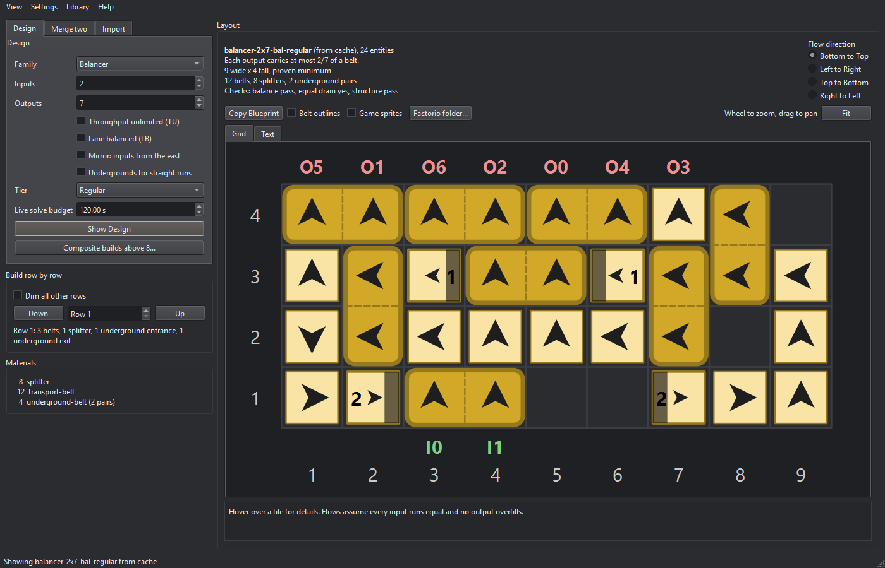

# Balancer for Factorio

Verified belt balancer designs for Factorio 2.x, drawn tile by tile and ready to copy into the game as blueprints.

[](https://github.com/FerrikWorks/Balancer-for-Factorio/releases/latest)




Inspired by Raynquist's Balancer Book. His designs and his notes on balancer construction guided the ruleset this program uses to generate and verify its designs.

## Contents

1. [Features](#features)
2. [Download and install](#download-and-install)
3. [Quick start](#quick-start)
4. [Design families](#design-families)
5. [Building in game](#building-in-game)
6. [How designs are verified](#how-designs-are-verified)
7. [Known limits](#known-limits)
8. [Frequently asked questions](#frequently-asked-questions)
9. [System requirements](#system-requirements)
10. [Uninstall](#uninstall)
11. [Feedback](#feedback)
12. [Credit and licence](#credit-and-licence)

## Features

1. **2080 verified designs.** Every size from 1 to 8 inputs and outputs, TU on and off, in all four belt tiers, across five design families.
2. **Copy Blueprint.** One click puts any design on the clipboard as a blueprint string.
3. **Two views.** A clear schematic grid, or the game's own art read from your Factorio install.
4. **Hover readout.** Each belt's flow and each splitter's priority and filter settings.
5. **Build row by row.** A row stepper and a materials list for building by hand.
6. **Rotate the view.** Show any design flowing up, down, left, or right to match your base.
7. **Merge two.** Join two balancers with the same output count into one build.
8. **Composite planner.** Step-by-step plans for builds above 8 belts, up to 64.
9. **Import and check.** Paste any blueprint or blueprint book and run the same checks on it.

## Download and install

1. Open the [latest release](https://github.com/FerrikWorks/Balancer-for-Factorio/releases/latest) and download `Balancer-for-Factorio-1.0.0-setup.exe`.
2. Run it. It installs to Program Files and adds a Start menu shortcut, with an optional desktop shortcut.
3. Start Balancer for Factorio from the Start menu.

### Windows SmartScreen

The installer is not code-signed. Balancer for Factorio is a free project, and code-signing certificates carry a yearly fee. Windows may show **"Windows protected your PC"** the first time you run the installer. To continue, click **More info**, then **Run anyway**.

To confirm the download is the one published here, compare its SHA-256 hash with the `.sha256` file attached to the release:

```powershell
Get-FileHash .\Balancer-for-Factorio-1.0.0-setup.exe -Algorithm SHA256
```

## Quick start

1. On the **Design** tab, choose the **Family**, the number of **Inputs** and **Outputs**, and the **Tier** of belt.
2. Tick **Throughput unlimited (TU)** if any number of inputs must be able to feed the same number of outputs at full speed. Tick **Lane balanced (LB)** to balance both lanes of every output.
3. Click **Show Design**. The grid draws the layout, with inputs marked in green below it and outputs in red above it.
4. Click **Copy Blueprint**.
5. Import the blueprint into the game to place it or add it to your collection: in Factorio, open the blueprint library and use **Import string**.

## Design families

| Family | Inputs | Outputs |
|---|---|---|
| Balancer | South edge | North edge |
| Lane-balanced balancer | South edge | North edge, both lanes of every output balanced |
| Corner balancer | West edge; tick Mirror for the east edge | North edge |
| Split-side balancer | Divided between the west and east edges | North edge |
| Lane balancer row | South edge, one unit per belt | North edge |

Each family covers 1 to 8 inputs and outputs, with TU on and off, in regular, fast, express, and turbo belts.

## Building in game

1. The blueprint carries every splitter setting: input and output priority, and the deconstruction planner filter that turns a splitter into a merger. Pasting it places them for you.
2. Building by hand, use **Build row by row** to step through the layout one row at a time, with each row's parts listed, and the **Materials** list for the full count.
3. Numbered tiles mark underground pairs. Hover an entrance to see its exit.
4. Feed only the inputs the grid marks. Some designs, such as every 1-n balancer, leave one half of a splitter open on the input edge; leave it empty.
5. For more than 8 belts, open **Help, Composite builds above 8**. The planner gives each step and the library designs to use.

## How designs are verified

Every design passes these checks before it enters the library. Before release, every design was checked again from its exported blueprint, traced the way the game builds it: all 2080 pass.

| Check | Meaning |
|---|---|
| Balance | Each output carries an equal share of every input |
| Equal drain | When outputs back up, every input drains at the same rate |
| TU | Any k inputs into any k outputs move k full belts, for TU designs |
| Lane balance | Both lanes of every output carry an equal share of every input lane, for lane-balanced designs |
| Lane drain | Both lanes of every input drain at the same rate, for lane-balanced designs |

Balance is checked with exact fractions. TU is checked with max-flow over every input and output subset, then with a steady-state splitter model. Lane behaviour, including sideloads onto belts and undergrounds, follows rules confirmed by in-game tests.

## Known limits

Balance and lane balance are exact while no lane inside a design is full. At full load, belts back up inside the design: each output still carries the same total and each input still drains at the same rate, but the mix of inputs on each output can shift. Feeding only one lane of a belt fills that lane at half the belt's rate. In-game testing of program designs showed the same behavior as other best practice examples, so this is anticipated behavior.

## Frequently asked questions

**Does the program include any Factorio files?**
No. The game-art view reads sprite sheets from your own Factorio install while the program runs, and never copies or saves them. Without Factorio installed, the schematic view works on its own.

**Where does the program find Factorio?**
It looks for Factorio through Steam on every drive. If it can't find it, open **Settings, Factorio folder** and paste the path to your Factorio folder.

**Do the designs need mods?**
No. Every design uses only belts, undergrounds, and splitters from the base game.

**Where is my data kept?**
In `%LOCALAPPDATA%\FactorioBalancerTool`: the design library, designs you improve with the Library menu, and logs.

**Can I check a design from somewhere else?**
Yes. The **Import** tab takes any blueprint or blueprint book string, traces it, and shows which checks it passes.

## System requirements

1. Windows 10 or 11, 64-bit.
2. About 100 MB of disk space for the program, plus about 80 MB for the library it copies to `%LOCALAPPDATA%\FactorioBalancerTool` on first start.
3. Factorio installed, only for the game-art view.

## Uninstall

Uninstall from **Settings, Apps** in Windows, or from the Start menu shortcut.

The library in `%LOCALAPPDATA%\FactorioBalancerTool` stays in place, so a reinstall keeps it. To remove the program completely, delete that folder by hand after uninstalling. Deleting it erases any verification and improvement work done beyond the designs the program comes with.

## Feedback

Found a design that doesn't behave as shown? Open an [issue](https://github.com/FerrikWorks/Balancer-for-Factorio/issues) with the design ID from the summary line above the grid, such as `balancer-4x3-bal-regular`, and what you saw in game. The design ID names the family, size, TU setting, and tier, which is enough to reproduce it.

## Credit and licence

Inspired by Raynquist's Balancer Book. His designs and his notes on balancer construction guided the ruleset this program uses to generate and verify its designs. Designs that started from or use one of his layouts credit him in their blueprint descriptions.

Balancer for Factorio is freeware by Ferrik, FerrikWorks. See [LICENSE.txt](LICENSE.txt) for the licence and [THIRD_PARTY_LICENSES.txt](THIRD_PARTY_LICENSES.txt) for the libraries it uses.

Factorio is a trademark of Wube Software. This program is not affiliated with or endorsed by Wube Software.
